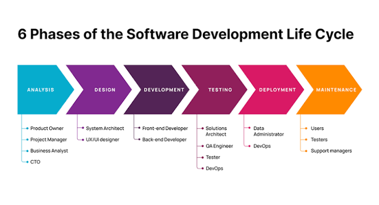
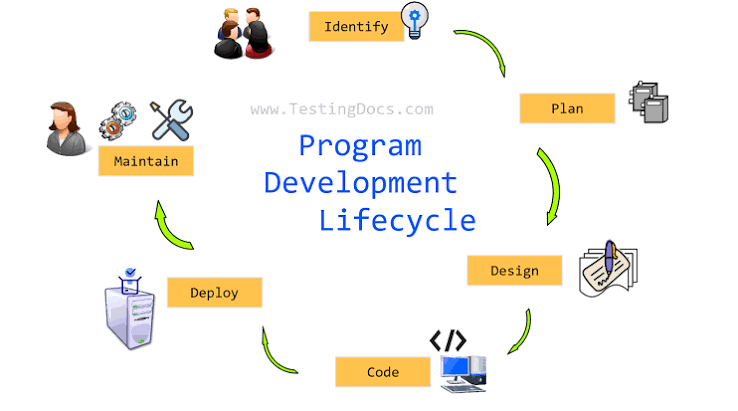

# 0)**Introduction To The Programming Language:
## 0.1)**What Is The Programming , And Programming Development Life Cycle (PDLC)?
The Programming , And Programming Development Life Cycle (PDLC) Is The Process Of Problem Solving...
[!Introduction To The Programming](https://github.com/MahmoudKhalidShabaanOmar100/Modern-Backend-Development-Features/blob/main/IntroductionToProgrammingWithJava/Class1/IntroductionToProgramming/IntroductionToProgrammingImages/IntroudctionToProgrammingImage.png)
### 0.1.1)**What Is The Input Of Your Own Java Computer Programming Codes?
**Input Refers To Different Data Or Data Items That Gets From The User Of Your Own Java Computer Programming Codes...

---------------------------------------------------------------------------------------------------------------------
### 0.1.2)**What Is The Process Of Your Own Java Computer Programming Codes?
**Process , Or Algorithm Refers To Different Operations , Methods , Or Processes On Different Inputs Of Your Own Java Computer Programming Codes To Get The Output Of Your Own Java Computer Programming Codes...

----------------------------------------------------------------------------------------------------------------------
### 0.1.3)**What Is The Output Of Your Own Java Computer Programming Codes?
**Output Refers To The Result Of Your Own Java Computer Programming Codes...

----------------------------------------------------------------------------------------------------
## 0.2)**What Is Different Steps Of The Programming , And Programming Development Life Cycle (PDLC)?
### 0.2.1)**Analyze The Problem Of Your Own Java Computer Programming Codes:
#### 0.2.1.1)**Understand Overall The Problem Of Your Own Java Computer Programming Codes...

----------------------------------------------------------------------------------------
#### 0.2.1.2)**Does The Java Computer Programming Codes Require User Interaction?
0.2.1.2.1)**What Is The Expected Inputs Of Your Own Java Computer Programming Codes?

-------------------------------------------------------------------------------------
0.2.1.2.2)**What Is The Output Of Your Own Java Computer Programming Codes?

----------------------------------------------------------------------------------------
#### 0.2.1.3)**Algorithm:
**Design Steps (Algorithms) Of Your Own Java Computer Programming Codes To Solve The Problem Of Your Own Java Computer Programming Codes...

----------------------------------------------------------------------
**It Is A Step By Step Of The Problem Solving Process...

-----------------------------------------------------------------------
## 0.2.2)**Implement The Algorithm:
-----------------------------------
0.2.2.1)**Implement The Algorithms In Your Own Java Computer Programming Codes...
----------------------------------------------------------------------------------
0.2.2.2)**Verify That The Algorithm Works In Your Own Java Computer Programming Codes Work...
---------------------------------------------------------------------------------------------
## 0.2.3)**Maintenance The Algorithm Of Your Own Java Computer Programming Codes:
**Use , And Modify Your Own Java Computer Programming Codes If The Problem Domain Changes...

<table>
  <tr>
    <td>
      <strong>Programming Development Life Cycle...</strong>
       
      
    </td>
    <td>
      <strong>Programming Development Life Cycle...</strong>
       
      
    </td>
  </tr>
</table>

[!Rectangle Area](https://github.com/MahmoudKhalidShabaanOmar100/Modern-Backend-Development-Features/blob/main/IntroductionToProgrammingWithJava/Class1/IntroductionToProgramming/IntroductionToProgrammingImages/RectangleAreaExample.png)

--------------------------------------------------------------------------------------------
> [!Important]
> Algorithm Is A Step By Step Of Problem Solving Processes Of Your Own Java Computer Programming Codes...
>  
> PDLC Refers To The Programming Development Life Cycle...
>  
> PDLC , Or Programming Is A Process Of Problem Solving...
-----------------------------------------------------------------------------------------------
> [!Tip]
> You Must Use , Or Modify The Problem Of Your Own Java Computer Programming Codes If The User Changes In The Problem By Adding Features , Or Removing Features...
>  
> To Sum Up , Then At The Frist You Must Think About The Problem , And Then Written Codes Of Your Own Java Computer Programming Codes...

[!To Sum Up!](https://github.com/MahmoudKhalidShabaanOmar100/Modern-Backend-Development-Features/blob/main/IntroductionToProgrammingWithJava/Class1/IntroductionToProgramming/IntroductionToProgrammingImages/ThinkingThenWrittingCodes.png)

-------------------------------------------------------------------------------------------------
> [!Warning]
> You Must Verify That The Algorithm Of Your Own Java Computer Programming Codes Works...
