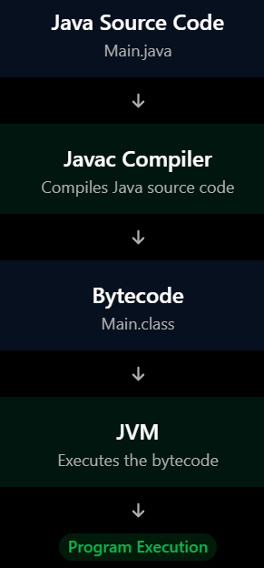
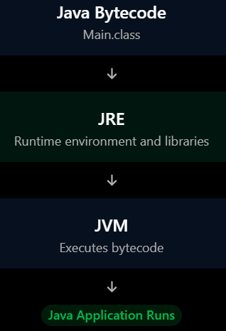
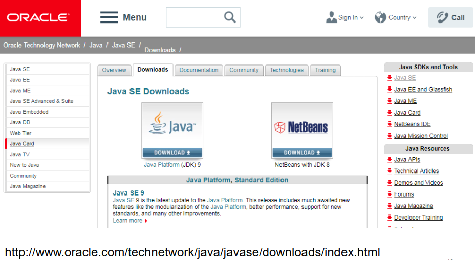
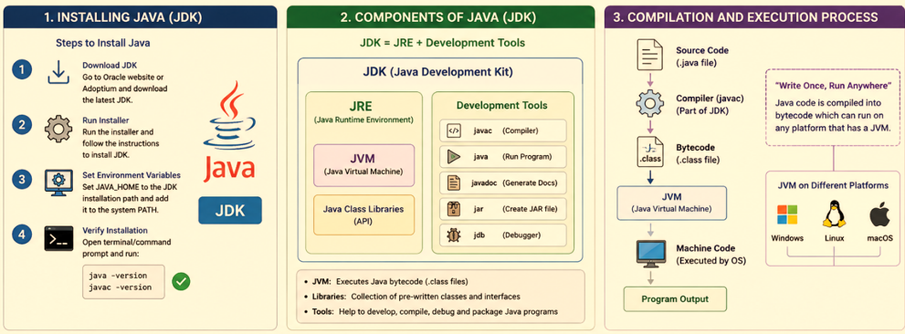

# 01)**How To Install The Java Programming Language:

## 01.1)**What Is The JDK?

- JDK Refers To The Java Development Kit , It Is A Software Development That Provide Different Software Tools Like Compile , Run , Execute , And Debug You Own Java Computer Programming Applications.
-------------------------------------------------------------- 
- In The Simple , The JDK Is A Software Development That Mainly Used To Write Java Computer Programming Codes , And Converted From File.java To File.class.
--------------------------------------------------------------  
-  There Are Different Features Inside JDK:
--------------------------------------------
01.1.1)**JRE: It Refers To The Java Runtime Environment , It Is Mainly Used To Run , Or Execute Your Own Java Computer Programming Codes.

--------------------------------------------
01.1.2)**JVM: It Refers To The Java Virtual Machine , It Is Mainly Used To Execute The Bytecode File Of Your Own Java Computer Programming Codes.

--------------------------------------------
01.1.3)**JAVAC: It Is A Java Compiler That Converts .Java File Into .Class File...

--------------------------------------------
01.1.4)**Java: It Launches , Or Executes Java Applications.

--------------------------------------------
01.1.5)**JDB: It Refers To The Java Debuger , It Is Mainly Used To Debug Your Java Applications...

---------------------------------------------
01.1.6)**JavaDOC: It Refers To The Java Documentation , It Is Mainly Used To Generate Documentation For The Java Computer Programming Codes...

----------------------------------------------

-----------------------------------------------
## 01.2)**What Is The JRE?

- 01.2.1)**It Is A Software Development Environment That Contains All Different Features To Run , Or Execute Your Own Java Computer Programming Codes...
-----------------------------------------------
- 01.2.2)**There Are Different Features Of The JRE:
---------------------------------------------------
01.2.2.1)**JVM: It Refers To The Java Virtual Machine , It Is Mainly Used To Execute The Bytecode File Of Your Own Java Computer Programming Codes...
----------------------------------------------------
01.2.2.2)**Java Class Libraries: It Contains Different Methods , And Classes...
----------------------------------------------------
01.2.2.3)**Runtime Supporting Files: It Is Used To Run , Or Execute Your Own Java Computer Programming Codes...
----------------------------------------------------

-----------------------------------------------------
## 01.3)**What Is The JVM?

**It Refers To The Java Virtual Machine , It Is Mainly Used To Run , Or Execute The Bytecode File (File.class) Of Your Own Java Computer Programming Codes...

------------------------------------------------------

-------------------------------------------------------
<table>
  <tr>
    <td>
      
    </td>
    <td>
      
    </td>
  </tr>
</table>
