# 02)**Your Frist Java Project:
02.1)**Any Java Computer Programming Codes At Least Consist Of At Least One Class For More Than One Class...

------------------------------------------
02.2)**What Is The Class In The Java Computer Programming Codes?

----------------------------------------------------------------
### Class:
- It Is A Group Of Data Items (Data , Or Inputs) , And Methods (Functions , Or Operations)...
    - What Is The Data Item?
          - Data Item Inside Class Refers To Different Inputs That Gets From The User Of Your Own Java Computer Programming Codes...
    - What Is The Method?
          - Method Refers To Different Operations , And Functions That Work On The Input To Display The Result Of Your Own Java Computer Programming Codes...
- Any Java Computer Programming Codes Must Be Inside The Class... Like public class {}...
-----------------------------------------------------------------
02.3)**Any Java Computer Programming Codes Must Contain Only One Main Method Like public static void main(String[] args){} To Start Run , Or Execute Your Own Java Computer Programming Codes From This Point , Because It Is The Entry Point , Or Starting Point...

-----------------------------------------------------------------
02.4)**Main Method Contains All Java Codes Of Your Own Java Computer Programming Codes...

-----------------------------------------------------------------
02.5)**If You Want To Print A Statement For Different Users Of Your Own Java Computer Programming Codes By Using: System.out.print("Message Text..."); Like:
-----------------------------------------------------------------
- System: It Is A Java Package From The Java Programming Language That Contains Different Classes And Method Like out , print , And More , But The Frist Letter Of S Inside System Keyword Must Be A Capital Letter...
- out: It Is A Class From The System Java Package From The Java Programming Language...
- print: It Is A Method (Operation) From The out Class From The System Java Package From The Java Programming Language To Print A Message Text For The User Of Your Own Java Computer Programming Codes...
-------------------------------------------------------------------
<table>
  <tr>
    <td>
      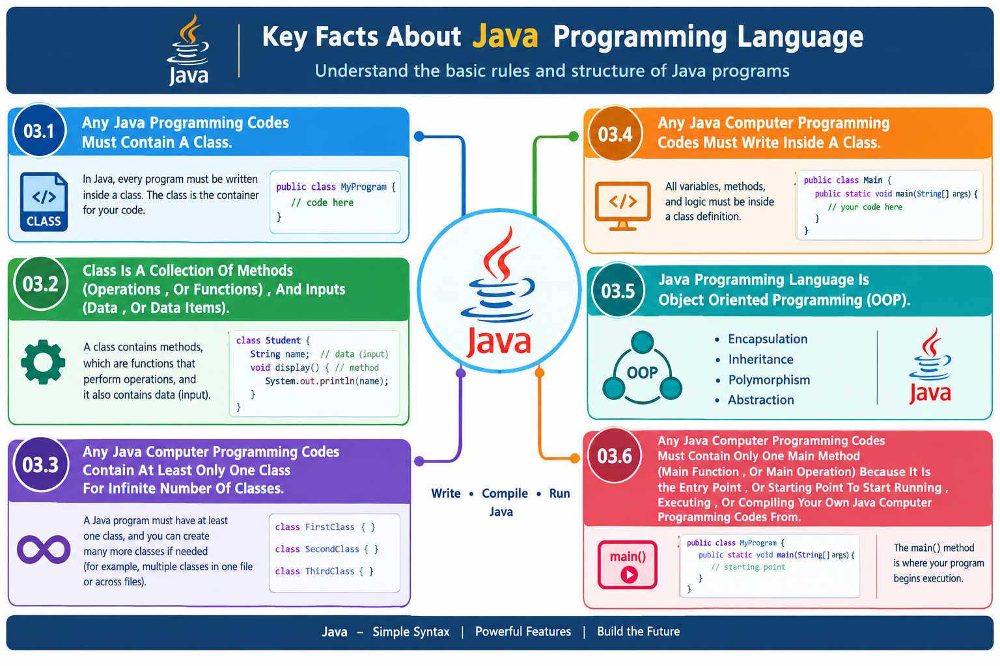
    </td>
  </tr>
</table>

02.6)**Any Java Computer Programming Line Code Must End With Semicolon (;) , To Know Different Text Editors (IDEs) Like Visual Studio Code (VS Code) , NetBeans , Eclipise , And More That It Is The Ending Of The Java Computer Programming Code Line...

<table>
  <tr>
    <td>
      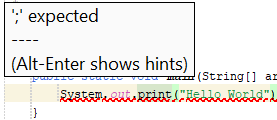
    </td>
  </tr>
</table>

#### 02.7)**There Are Different Comments In The Java Computer Programming Language:

- // : It Is Mainly Used To Make A Single Line Comment In Your Own Java Computer Programming Codes...
--------------------------------------------------------------------------------------
- /**/ : It Is Mainly Used To Make A Multiple Lines Comments In Your Own Java Computer Programming Codes...
---------------------------------------------------------------------------------------
- Any Comments Like Single Line Comment , Or Multiple Lines Comments Does Not Appear For Different Users Of Your Own Java Computer Programming Codes , But It Is Used As A Documentation For Different Users To Know The Main Purpose Of Using This Java Code Line For Different Users , And Others Developers...
----------------------------------------------------------------------------------------
<table>
  <tr>
    <td>
      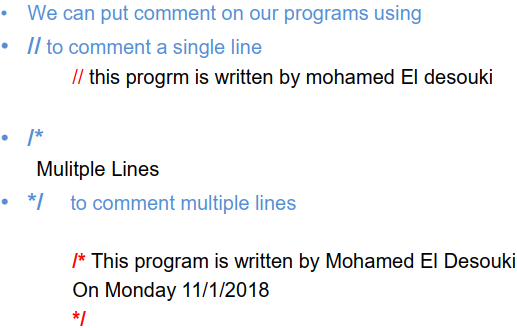
    </td>
  </tr>
</table>
02.8)**Java Programming Language Is A Case Sensitive Programming Language , This Means That The Java Programming Language Is Affected By The Capital Letters , Or Small Letters...
<table>
  <tr>
    <td>
      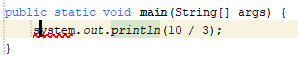
    </td>
    <td>
      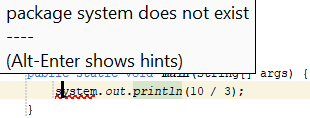
    </td>
  </tr>
</table>

#### 02.9)**What Is The Processing Of Your Own Java Computer Programming Codes?

  - 02.9.1)**Create The Source Codes Of Your Own Java Computer Programming Codes (File.java)...
  - 02.9.2)**Saved The Source Codes Of Your Own Java Computer Programming Codes On The Disk...
      - Source Codes Of Your Own Java Computer Programming Codes Developed By The Developer...
  - 02.9.3)**Compile The Source Codes Of Your Own Java Computer Programming Codes To Get The ByteCode Of Your Own Java Computer Programming Codes...
  - 02.9.4)**ByteCode File Of Your Own Java Computer Programming Codes Stored On The Disk...
      - ByteCode Is Developed By The Compiler For The JVM (Java Virtual Machine) To Read , Or Interrput Not For You To Understand...
  - 02.9.5)**Compile The ByteCode Of Your Own Java Computer Programming Codes...
  - 02.9.6)**Displaying The Result (Output) Of Your Own Java Computer Programming Codes...
<table>
  <tr>
    <td>
      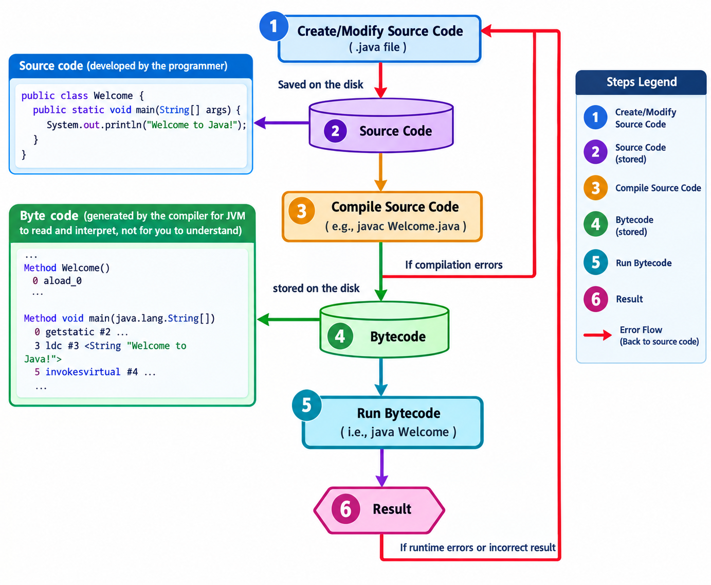
    </td>
  </tr>
</table>

#### 02.10)**What Is Different Java Computer Programming Errors?

  - Java Computer Programming Error Refers To Different Programming Errors That Returning By The Text Editor (IDE) Like Visual Studio Code (VS Code) , NetBeans , Or ETC...
-------------------------------------------------------------------------------
- There Are Different Types Of The Programming Errors Like:

- Syntax Error: It Is A Type Of Programming Errors That Detected By The Compiler Like Visual Studio Code (VS Code) , NetBeans , Or ETC Like Forgot Semicolon (;) At The End Of Any Java Line Code , Forget The Closing Brackets At The End Of Any Class } , Or ETC...

<table>
  <tr>
    <td>
      
    </td>
    <td>
      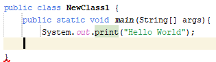
    </td>
    <td>
      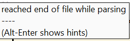
    </td>
  </tr>
</table>
      
- Runtime Error: It Is A Type Of Programming Errors That Causes Your Own Java Computer Programming Codes To Abort Like Dividing The Number By Zero , Dividing By Negative Number Or ETC...

<table>
  <tr>
    <td>
      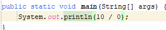
    </td>
    <td>
      
    </td>
  </tr>
</table>

- Logical Error: It Is A Type Of Programming Errors That Produces Incorrect Result Of Your Own Java Computer Programming Codes...

<table>
  <caption>The Result Of This Program Should Be 3.3333333333 , Not Integer 3....</caption>
  <tr>
    <td>
      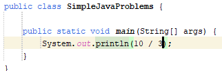
    </td>
    <td>
      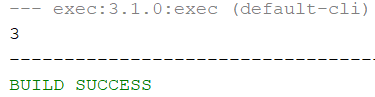
    </td>
  </tr>
</table>
<table>
  <tr>
    <td>
      <strong>Your Frist Java Project...</strong>
       
      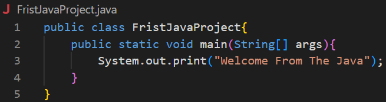
    </td>
    <td>
      <strong>Result Of Your Frist Java Project...</strong>
       
      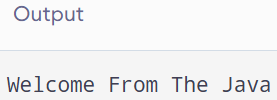
    </td>
  </tr>
</table>
<table>
  <tr>
    <td>
      
    </td>
    <td>
      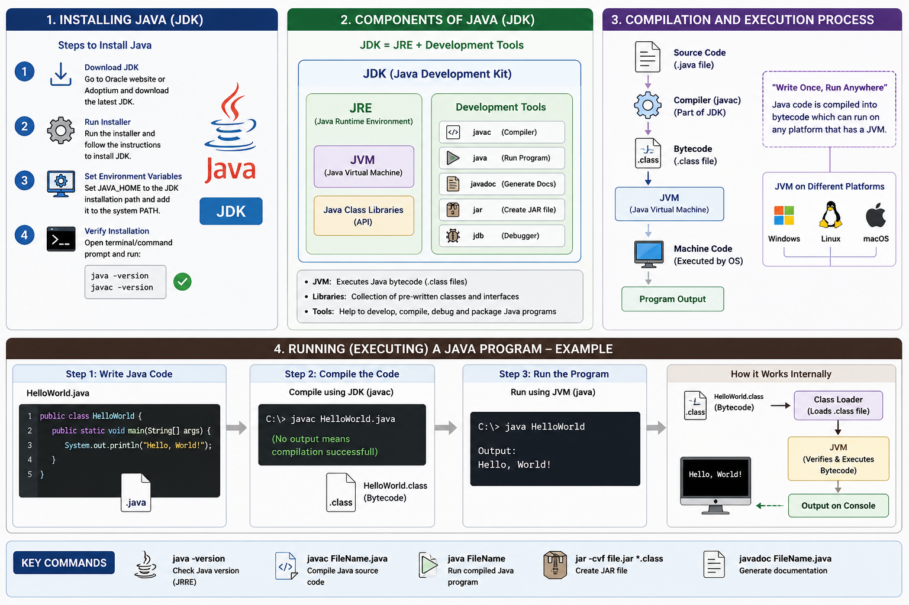
    </td>
  </tr>
</table>
