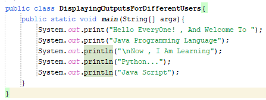
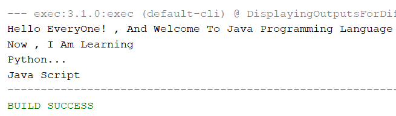
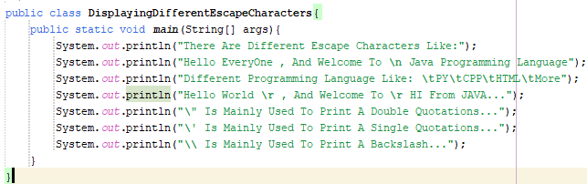
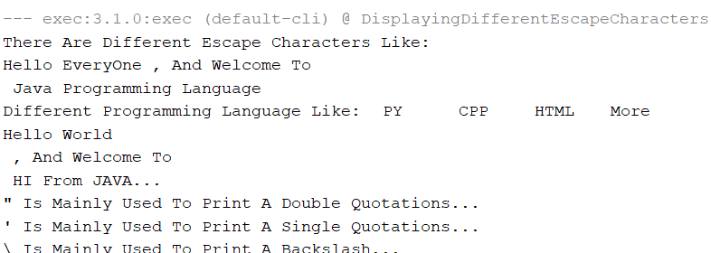
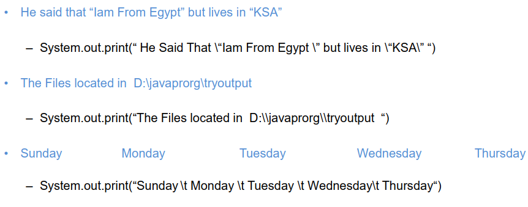
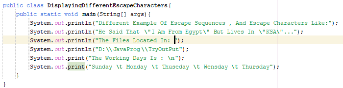
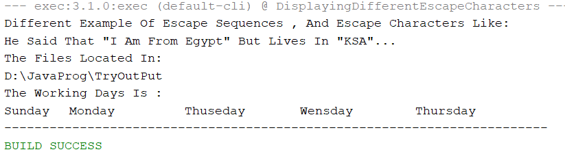

# 03)**Displaying Outputs For Different Users:

## 03.1)**There Are Different Methods Of Displaying Outputs Like:

### 03.1.1)**System.out.print("Message Text");

  - It Is Mainly Used To Display A Message Text In The Same Line...

### 03.1.2)**System.out.println("Message Text");

  - It Is Mainly Used To Display A Message Text In The New Line , It Is Mainly Used To Break The Text Message Into New Line...

<table>
  <tr>
    <td>
      
    </td>
    <td>
      
    </td>
  </tr>
</table>
## 03.2)**What Is The Escape Sequence , Or Escape Character?

  - Escape Sequence , Or Escape Character: It Is The Way Of Formatting Different Message Texts That Displaying For Different Users Of Your Own Java Computer Programming Codes...
  - There Are Different Ways Of Escape Sequences , Or Escape Characters Like:
    - "\n" , Or '\n': New Line , Or New Position , It Is Mainly Used To Break The Text Into New Line , Position The Screen Cursor To The Begging Of The Next Line...
    - "\t" , Or '\t': Horizontal Tab , Move The Screen Cursor To The Next Tab Stop...
    - "\\" , Or '\\': Backslash , It Is Mainly Used To Print A Backslash In Your Own Java Computer Programming Codes...
    - "\"" , Or '\"': Double Quotations , It Is Mainly Used To Print A Double Quotations In Your Own Java Computer Programming Codes...
    - "\'" , Or '\'': Single Quotations , It Is Mainly Used To Print A Single Quotations In Your Own Java Computer Programming Codes...
    - "\r" , Or '\r': Carriage Return , It Is Mainly Used To Position The Screen Cursor To The Begging Of The Current Line , Not Advance To The Next Line...
  - Different Escape Characters , Or Escape Sequences Must Be Inside Single Quotations , Or Double Quotations To Tell Different Text Editors (IDEs) Like Visual Studio Code (VS Code) , NetBeans , Eclipise , Or ETC That It Is Not A Text But It Is A Formatting Escape Sequence Not An Original Text...

<table>
  <caption>Different Escape Characters , Or Different Escape Sequences...</caption>
  <tr>
    <td>
      
    </td>
    <td>
      
    </td>
  </tr>
  <tr>
    
  </tr>
  <tr>
    <td>
      
    </td>
    <td>
      
    </td>
  </tr>
</table>
