# 04)**Accepting Inputs From The User:

### 04.1)**If You Want To Get An Input From The User , There Are Different Steps To Get Input From The User Like:
#### 04.1.1)**You Must Import Scanner Class From The Java Package From The Util Package Like: import java.util.Scanner;
  - java: It Is A Java Package From The Java Programming Language , It Contains Different Packages , And Classes...
-----------------------------------------------------------------
  - util: It Is A Java Package From The Java Programming Language , It Contains Different Classes , And Methods...
-----------------------------------------------------------------
  - Scanner: It Is A Java Class From The util Package From The java Package , It Is Mainly Used To Get A Scanner From The Input..
-----------------------------------------------------------------

<table>
  <tr>
    <td>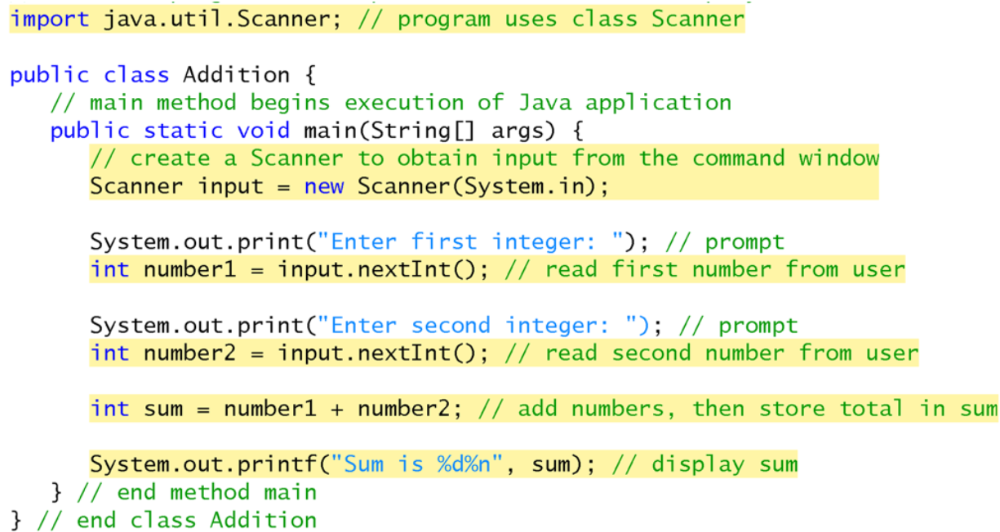</td>
  </tr>
</table>

-----------------------------------------------------------------
#### 4.1.2)**Create A Location To Store The Input That Gets From The User In The Memory , It Is Called Variable...
  - Variable: It Is A Location In The Computer Memory's Where The Value Can Be Stored For Used By The Java Computer Programming Codes...
    - Variable Initialization: It Is Mainly Used To Initialize The Variable With Initial Value...
    - Variable Declaration: It Is Mainly Used To Declare The Variable With Name , And Data Type Before They Used In Your Own Java Computer Programming Codes...
    - Declaration: DataType Identifier;
    - Variable Name Is A Unique Name That You Must Not Use The Same Variable Name More Than One Use In The Same Java Computer Programming Codes...
    - There Are Different Ways Of The Variable Name In The Java Programming Language Like:
      - Snake Case: It Is Mainly Separated By Different Words In The Same Variable Name By Under Sccoer (_)... Like frist_user_name , user_age...
      - Camal Case: It Is Mainly Separated By Different Words In The Same Variable Name By Making The Frist Letter Of Any Words As A Capital Letter Else The Frist Word , It Is The Best Case In The Java Programming Language... Like fristUserName , userAge...
      - Pascal Case: It Is Mainly Separated By Different Words In The Same Variable Name By Making The Frist Letter Of An Words As A Capital Letter Like FristUserName , UserAge...
      - Upper Snake Case: It Is Mainly Separated Different Words In The Same Variable Name By Making All Characters As A Capital Letters , And Separated By Each Words By Using Under Sccoer Like FRIST_USER_Name , USER_AGE...

<table>
  <tr>
    <td>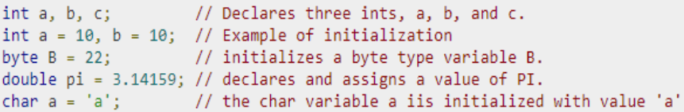</td>
  </tr>  
</table>

-----------------------------------------------------------------
#### 4.1.3)**Determine The Data Type Of The Variable Name Between Different Data Types From The Java Programming Language Like:
<table>
  <thead>
    <tr>
      <th>DataType Name:</th>
      <th>DataType Abbreviation:</th>
      <th>DataType Size:</th>
      <th>Description</th>
    </tr>
  </thead>
  <tbody>
    <tr>
      <td>Character</td>
      <td>char</td>
      <td>1 Byte</td>
      <td>Characters , Or Small Integer Numbers...</td>
    </tr>
    <tr>
      <td>Integer</td>
      <td>int</td>
      <td>4 Byte</td>
      <td>Integer Number Only , Not Floating...</td>
    </tr>
    <tr>
      <td>Float</td>
      <td>float</td>
      <td>4 Byte</td>
      <td>Floating Point Number...</td>
    </tr>
    <tr>
      <td>Short Integer</td>
      <td>short int</td>
      <td>2 Bytes</td>
      <td>Short Integer Number...</td>
    </tr>
    <tr>
      <td>Long Integer</td>
      <td>long int</td>
      <td>4 Bytes</td>
      <td>Long Integer Number...</td>
    </tr>
    <tr>
      <td>Boolean</td>
      <td>bool</td>
      <td>4 Bytes</td>
      <td>Boolean Value</td>
    </tr>
    <tr>
      <td>Double</td>
      <td>double</td>
      <td>8 Bytes</td>
      <td>Double Precision Floating Point Numbers...</td>
    </tr>
    <tr>
      <td>Long Double</td>
      <td>long double</td>
      <td>8 Bytes</td>
      <td>Long Double Precision Floating Point Numbers</td>
    </tr>
    <tr>
      <td colspan="4">
        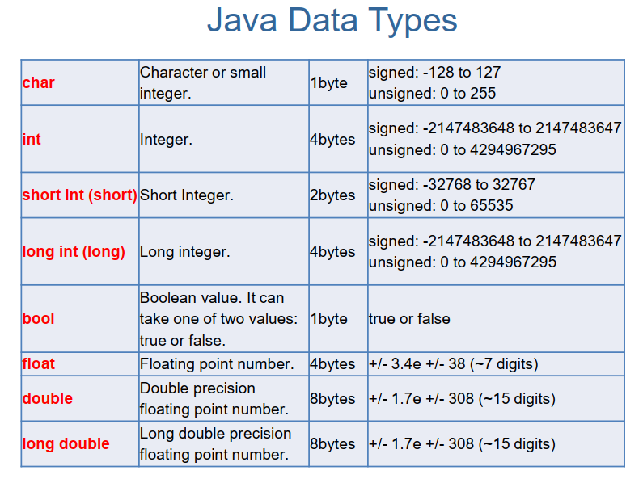
      </td>
    </tr>
    <tr>
      <td colspan="2">
        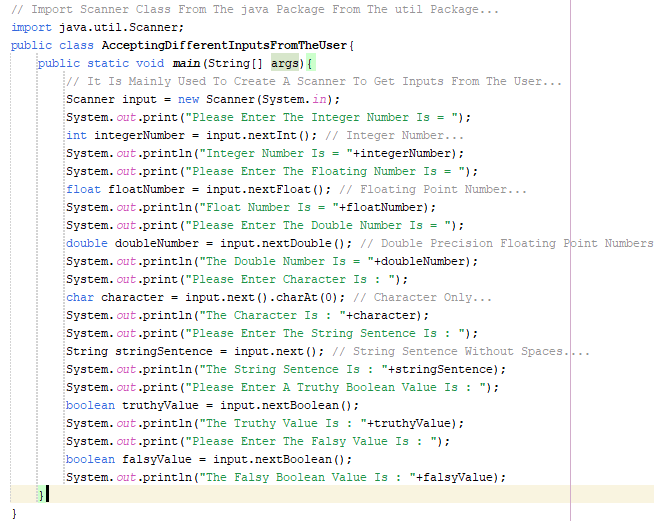
      </td>
      <td colspan="2">
        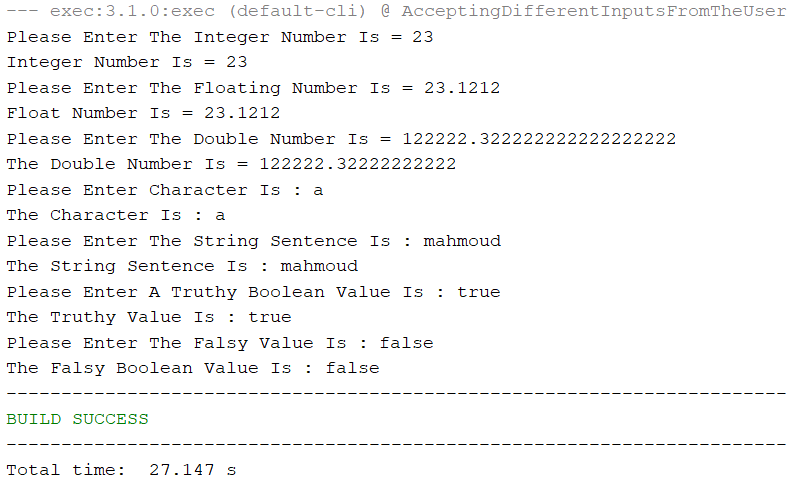
      </td>
    </tr>
  </tbody>
</table>

>[!Important]
>The Value Of The Boolean Data Type Can Be One Of Only Two Values True (If The Condition Is TRUE) , Or False (If The Condition Is FALSE)...
>  
>The Variable In Any Java Computer Programming Codes Must Be A Descriptive Variable Name...
>  
>The Most Common Method Of The Variable Name In Your Own Java Computer Programming Codes Is A camelCaseMethod...

-----------------------------------------------------------------
>[!Tip]
>You Can Declare The Variable Without Initializing The Variable...
>  
>You Must Declare The Variable At The Frist Before Initializing The Variable...
>  
>You Can Declare , And Initialize The Variable With Data Type , Name , And Initial Value In The Same Line...
------------------------------------------------------------------
>[!Warning]
>You Should Know That The Frist Letter Of The Scanner Class Must Be A Capital Letter.
-------------------------------------------------------------------------------------

#### Example 1: Rectangle Area:

<table>
  <tr>
    <td>
      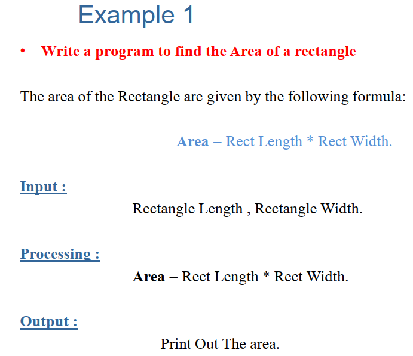
    </td>
    <td>
      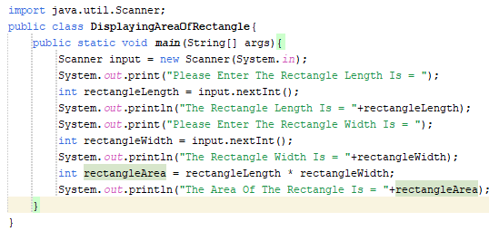
    </td>
    <td>
      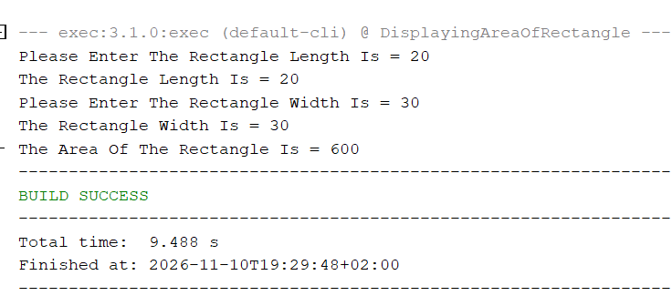
    </td>
  </tr>
</table>

-------------------------------------------------------------------------------------------
#### Example 2: Sum Of Two Integer Numbers: 

<table>
  <tr>
    <td>
      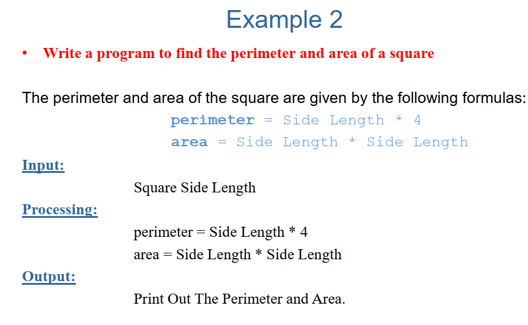
    </td>
    <td>
      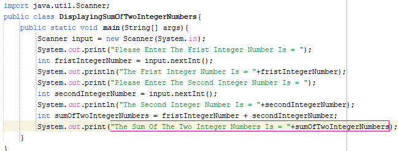
    </td>
    <td>
      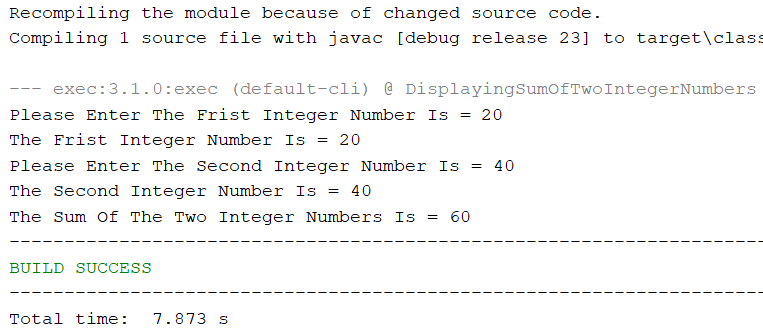
    </td>
  </tr>
</table>

----------------------------------------------------------------------------------------------
#### Example 3: Square Area And Perimeter:

<table>
  <tr>
    <td>
      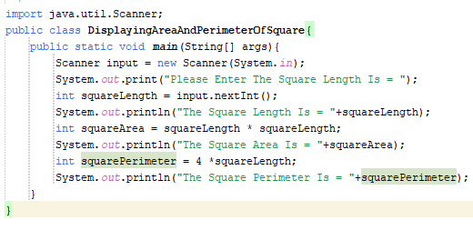
    </td>
    <td>
      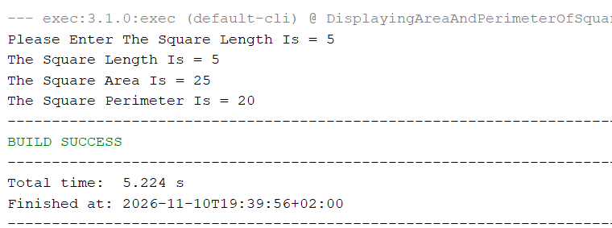
    </td>
  </tr>
</table>
